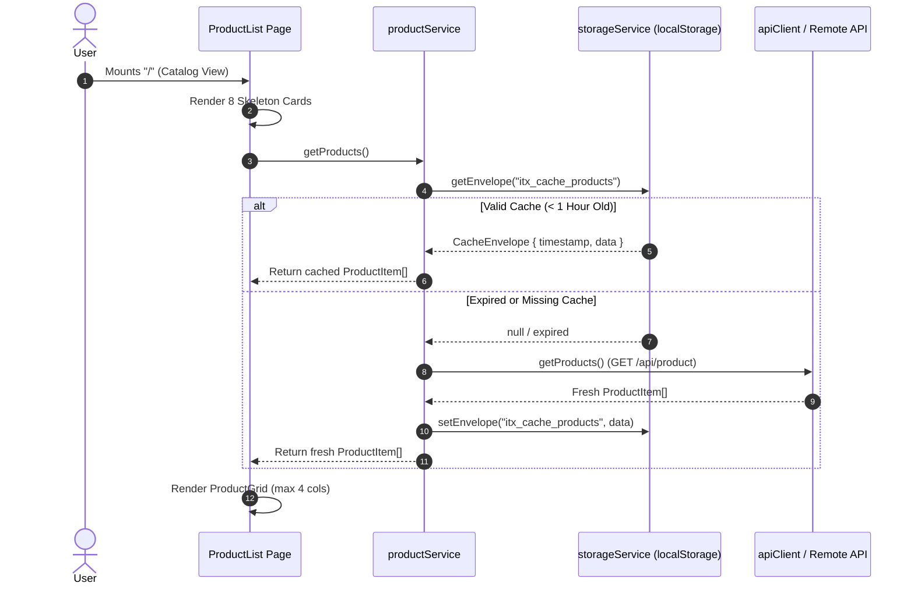
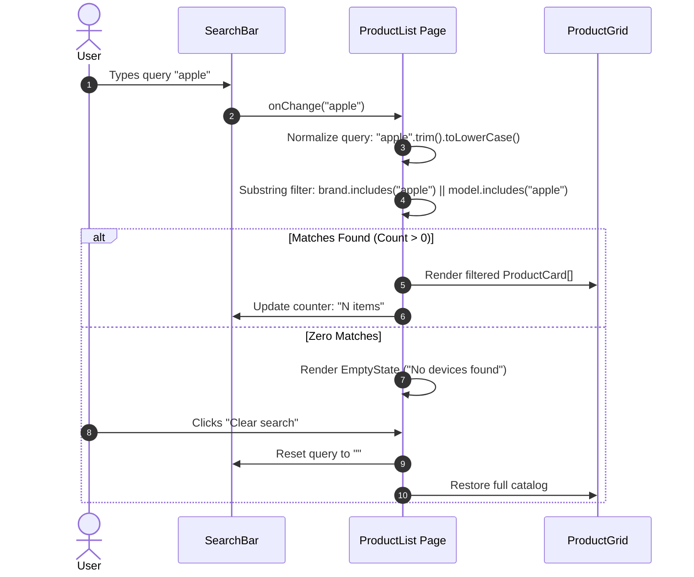

# Flow: Catalog Browsing & Real-Time Search

This document describes the user journey, sequence flows, and caching interactions for the **Product List Page (PLP)** (`/`).

---

## 1. Catalog Initial Load & Caching Lifecycle

When a user visits the storefront (`/`), the application attempts to load the device catalog from client storage first. If a valid cache envelope exists (age < 1 hour), the catalog renders instantly with zero network round-trips. Otherwise, it retrieves fresh data from the remote API while displaying 8 animated skeleton cards.

---

## 2. Real-Time Search Filtering Flow

As the user enters text into the search input positioned on the top right, `ProductList` filters the in-memory array synchronously with `useMemo`.

---

## 3. Error Recovery & Retry Flow

If the initial network request fails and no valid cache is available:
1. `ProductList` enters the error state, hiding the skeletons.
2. An accessible error banner (`role="alert"`) displays the error message and an interactive **Retry** button.
3. Clicking **Retry** invokes `productService.getProducts({ forceRefresh: true })`, forcing a fresh network request and restoring the catalog on success.

---

## 4. Responsive Breakpoints

Adhering to the visual specification in `workflow/backlog/raw/PLP.png`:

| Viewport | Width | Columns | Gap | Notes |
| :--- | :--- | :--- | :--- | :--- |
| **Desktop** | `> 1024px` | **4** | `24px` | Strict requirement: at most 4 items per row |
| **Tablet** | `769px – 1024px` | **3** | `16px` | Smooth reflow |
| **Small Tablet** | `541px – 768px` | **2** | `16px` | Compact grid |
| **Mobile** | `≤ 540px` | **1** | `16px` | Full-width single column cards |
