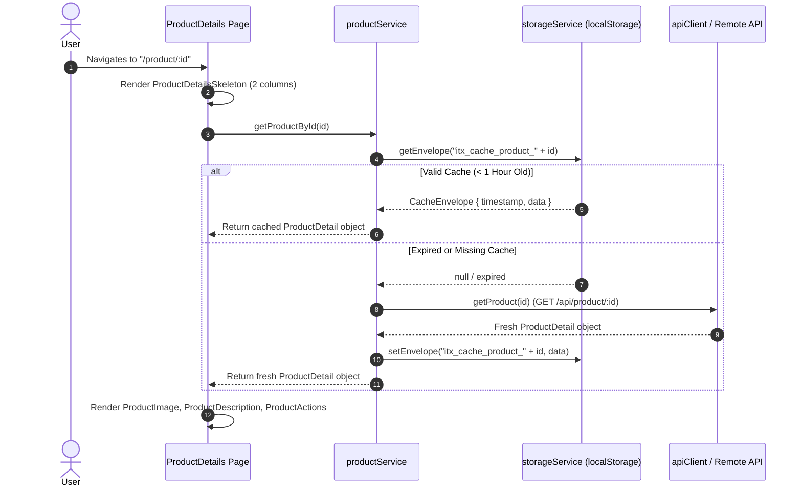
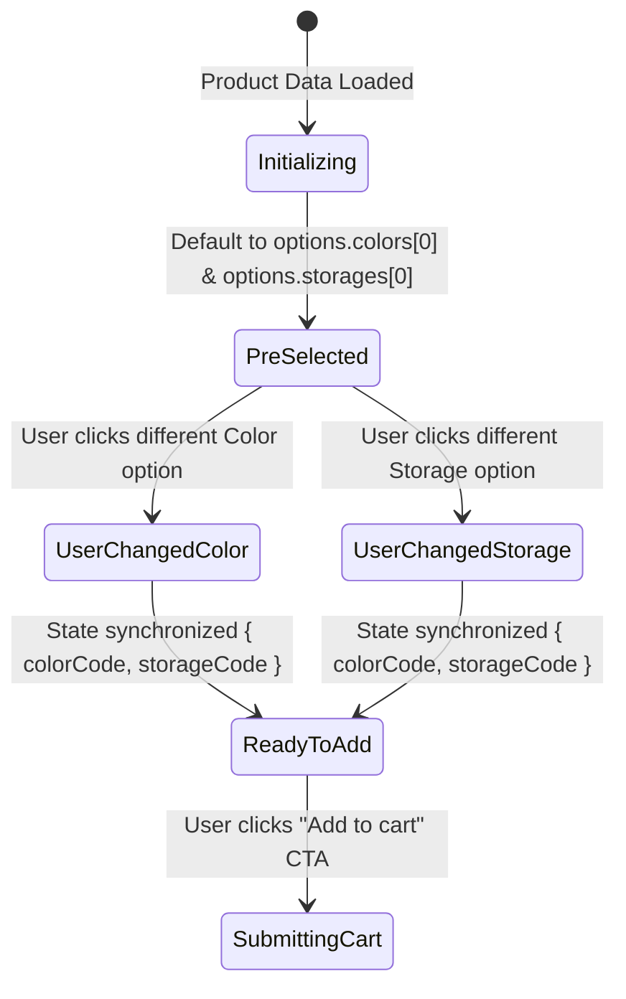
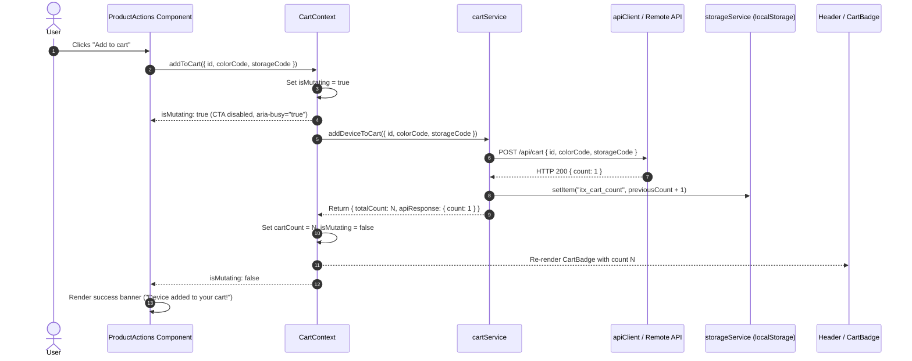

# Flow: Product Details View, Variant Selection & Cart Mutation

This document describes the user journey, sequence flows, caching interactions, and cart mutation lifecycle for the **Product Details Page (PDP)** (`/product/:id`).

---

## 1. Product Details Fetch & Caching Lifecycle

When a user navigates to `/product/:id`, the application attempts to load the device specifications from client storage first. If a valid cache envelope exists (`itx_cache_product_<id>`, age < 1 hour), the specifications and image render immediately without an extra network request. Otherwise, it retrieves fresh data from the remote API while displaying a two-column shimmer skeleton placeholder.



---

## 2. Variant Selection & Default Pre-Selection

Adhering strictly to the technical test specification:
- Both **Storage** and **Color** selectors are always displayed, **even if there is only one option available**.
- The first available option for both Storage and Color is **selected by default** upon page render.
- The user can toggle between available options using accessible radio button groups (`role="radiogroup"` / `role="radio"` with `aria-checked`).



---

## 3. Cart Addition & Header Synchronization Flow

When the user clicks the "Add to cart" CTA:
1. `ProductActions` invokes `addToCart({ id, colorCode, storageCode })` from `CartContext`.
2. `CartContext` marks `isMutating = true`, disabling the CTA button and rendering "Adding to cart..." with `aria-busy="true"`.
3. `cartService.addDeviceToCart` sends `POST /api/cart` with `{ id, colorCode, storageCode }`.
4. Upon successful response `{ count: 1 }`, the client accumulator increments the stored count in `storageService` (`itx_cart_count`).
5. `CartContext` updates `cartCount`, triggering a reactive update in the `Header`'s `CartBadge`.
6. `ProductActions` displays a temporary success alert banner (`role="status"`) and restores button interactivity.



---

## 4. Error Handling & Recovery Strategies

### 4.1 Device Not Found (404 View)
- If the device ID does not exist in the API, `productService` throws an `ApiError` with status `404`.
- The page renders `pdp-not-found` with a clear explanation and an interactive **Return to Catalog** button/link targeting `/`.

### 4.2 Network or Server Error on Details Fetch
- If fetching fails due to network outage or API error (non-404), an error state banner is displayed with the error message.
- A **Retry** button triggers `productService.getProductById(id, { forceRefresh: true })`, bypassing corrupted cache entries.

### 4.3 Cart Mutation Failure
- If `POST /api/cart` fails, `CartContext` captures the error in `mutationError`.
- An accessible alert (`role="alert"`) displays the failure message above the CTA button.
- User-selected options (Color and Storage) are **preserved**, enabling immediate re-submission without reconfiguring the device.

---

## 5. Technical Specifications Attribute Mapping

All attributes are rendered in `ProductDescription` with defensive null-safe fallbacks:

| Display Label | API Property | Fallback Strategy | Notes |
| :--- | :--- | :--- | :--- |
| **Brand** | `brand` | `'-'` | Displayed prominently in header and specs |
| **Model** | `model` | `'-'` | Used for page `<h1>` and breadcrumbs |
| **Price** | `price` | `'-'` | Formatted via `formatPrice` (`XX €`) |
| **CPU** | `cpu` | `'-'` | Processor specification string |
| **RAM** | `ram` | `'-'` | Memory capacity |
| **Operating System** | `os` | `'-'` | OS family and version |
| **Screen Resolution**| `displayResolution` | `'-'` | Screen dimensions and pixel density |
| **Battery** | `battery` | `'-'` | Battery capacity |
| **Cameras** | `primaryCamera`, `secondaryCmera` | `'-'` | Handles API typo `secondaryCmera` and string/array forms |
| **Dimensions** | `dimentions` / `dimensions` | `'-'` | Handles API typo `dimentions` (with 'e') |
| **Weight** | `weight` | `'-'` | Formatted with `g` suffix when numeric |

---

## 6. Responsive Two-Column Layout

Adhering to the visual specification in `workflow/backlog/raw/PDP.png`:

```
+-------------------------------------------------------------+
| Header: Brand Logo / Breadcrumbs / Cart Badge               |
+-------------------------------------------------------------+
| [ < Return to device catalog ]                              |
|                                                             |
| +---------------------------+ +---------------------------+ |
| |                           | | Brand / Model Name / Price| |
| |                           | |                           | |
| |      COLUMN 1: IMAGE      | |    COLUMN 2: DESCRIPTION  | |
| |                           | | (11 Technical Attributes) | |
| |      [ ProductImage ]     | |                           | |
| |                           | |---------------------------| |
| |                           | |    COLUMN 2: ACTIONS      | |
| |                           | | [Storage Option Pills]    | |
| |                           | | [Color Option Pills]      | |
| |                           | | [ Add to cart CTA Button ]| |
| +---------------------------+ +---------------------------+ |
+-------------------------------------------------------------+
```

| Viewport | Column 1 (Image) | Column 2 (Specs & Actions) | Layout Mode |
| :--- | :--- | :--- | :--- |
| **Desktop (> 900px)** | `45%` width, sticky | `55%` width | 2-column side-by-side (`grid 1fr 1.2fr`) |
| **Tablet (641px - 900px)** | `40%` width | `60%` width | 2-column side-by-side (`grid 1fr 1.2fr`) |
| **Mobile (≤ 640px)** | `100%` width, centered | `100%` width | Single-column stacked vertical layout |
