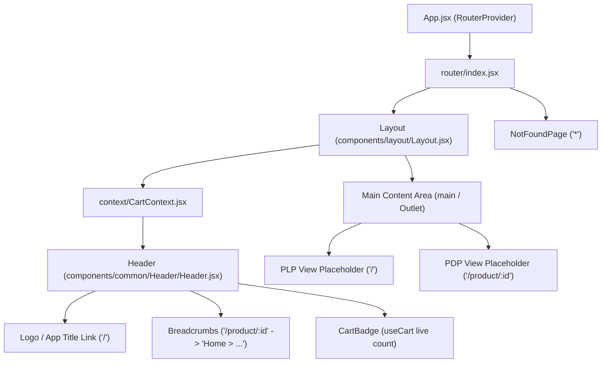

# Technical Design — Application Shell, Client Routing, and Global Header

## Context

This design establishes the architectural foundation for the mobile device e-commerce SPA. See [proposal.md](proposal.md) for business motivation. The implementation adheres to [/docs/technical-decisions.md](../../../docs/technical-decisions.md) (React 19, React Router v7 Library Mode, Vite, Vanilla CSS/CSS Modules, and English UI copy).

---

## Goals / Non-Goals

**Goals:**
- Scaffolding a clean, senior-grade modular project structure in `/src`.
- Setting up React Router v7 with a root `Layout`, child view outlets, and a 404 catch-all route.
- Building a sticky `Header` with logo home navigation, responsive breadcrumbs, and live cart counter badge.
- Establishing the core design token system (`variables.css` and base resets) with responsive layout containers.
- Configuring Vitest and React Testing Library with passing baseline test suites.

**Non-Goals:**
- External API client implementation and 1-hour cache TTL persistence (scoped to `ITX-002`).
- Product List Page device grid and search filtering (scoped to `ITX-003`).
- Product Details Page attributes and cart mutation (scoped to `ITX-004`).

---

## Architecture & Component Breakdown



### Directory Structure

```
src/
├── assets/                  # SVG icons (cart icon, logo)
├── components/
│   ├── common/
│   │   ├── Breadcrumbs/     # Semantic <nav aria-label="Breadcrumb">
│   │   ├── CartBadge/       # Cart icon with live counter badge
│   │   └── Header/          # Sticky header container
│   └── layout/
│       └── Layout/          # Layout shell wrapping <Header /> and <main>
├── context/
│   └── CartContext.jsx      # Reactive cart count state and provider
├── pages/
│   ├── NotFound/            # 404 catch-all page with home CTA
│   ├── ProductList/         # Placeholder for ITX-003
│   └── ProductDetails/      # Placeholder for ITX-004
├── router/
│   └── index.jsx            # React Router v7 createBrowserRouter configuration
├── styles/
│   ├── variables.css        # CSS custom properties (colors, typography, shadows)
│   └── global.css           # Modern CSS reset and typography
├── App.jsx                  # Root application entry
└── main.jsx                 # DOM mount
```

---

## Technical Decisions & Rationale

### 1. React Router v7 Configuration (`createBrowserRouter`)
- **Decision**: Configure routing using `createBrowserRouter` and `RouterProvider`.
- **Rationale**: Modern React Router v7 standard in SPA Library Mode. Enables clean nested routing where `Layout` serves as the root route component and pages render inside `<Outlet />`. Allows setting `errorElement: <NotFoundPage />` alongside a wildcard route (`path: '*'`).
- **Alternative Considered**: `<BrowserRouter>` with nested `<Routes>` — `createBrowserRouter` provides better separation of route definitions and native data router support.

### 2. State Decoupling for Cart Counter (`CartContext`)
- **Decision**: Implement `CartContext` and `useCart()` custom hook to manage `cartCount`.
- **Rationale**: The Header cart badge needs real-time reactive access to `cartCount` without tightly coupling to future product page components. The context initializes from `localStorage` (`itx_cart_count` or default `0`) and provides an increment method, ready for full mutation integration in `ITX-002` and `ITX-004`.
- **Alternative Considered**: Global Redux/Zustand — overkill for a focused SPA; React Context provides zero-dependency native state sharing.

### 3. Design Tokens & Styling Strategy (CSS Modules + `variables.css`)
- **Decision**: Use Vanilla CSS variables with CSS Modules (`Header.module.css`, `Layout.module.css`).
- **Rationale**: Adheres to ADR-006. Zero bundle runtime overhead, native scoping prevents style collisions, and CSS variables allow consistent theming across all current and future components.
- **Breakpoints**:
  - Desktop: `min-width: 1024px`
  - Tablet: `768px – 1023px`
  - Mobile: `< 768px`

### 4. Accessibility (WCAG 2.1 AA)
- Semantic landmarks: `<header role="banner">`, `<nav aria-label="Breadcrumb">`, `<main id="main-content">`.
- Breadcrumbs render an ordered list (`<ol>`) with `aria-current="page"` on the leaf item.
- Cart badge includes accessible text: `aria-label="Shopping cart: {count} items"`.
- Keyboard navigation: All interactive links and buttons have visible `:focus-visible` outlines.

---

## Risks / Trade-offs

- **[Risk] Deep-link refresh returning 404 in static production hosts**  
  $\rightarrow$ *Mitigation*: Vite development server natively falls back to `index.html`. For production builds, document standard single-page redirect rules in `docs/README.md`.
- **[Risk] Dynamic product title in breadcrumbs before detail fetch**  
  $\rightarrow$ *Mitigation*: The breadcrumb component parses router matches; if viewing `/product/:id` and a title is not yet available, it renders an elegant fallback indicator ("Product Details") without breaking navigation.
