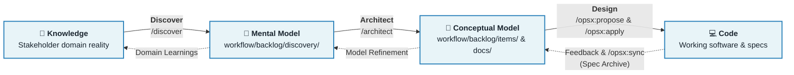

# Spec-Driven Development Template

A reusable, stack-agnostic base for working with **spec-driven development** on top of [OpenSpec](https://github.com/Fission-AI/OpenSpec).

The core idea: **Spec → Plan → Code.** Code is the last artifact produced, never the first. This workflow operationalizes the classic **Domain-Driven Design (DDD)** loop:



- **Discover (Knowledge → Mental Model)**: `/discover` conducts a guided requirements interview, producing a shared mental model in `workflow/backlog/discovery/<topic>.md`.
- **Architect (Mental Model → Conceptual Model)**: `/architect` slices the mental model into decoupled, verifiable backlog items (`workflow/backlog/items/`) while mapping ubiquitous language and system boundaries to `docs/`.
- **Design (Conceptual Model → Code)**: OpenSpec (`/opsx:propose`) creates the technical `design.md`, delta specs, and implementation steps, while `/opsx:apply` implements the code.
- **Continuous Feedback**: As code evolves or reality drifts, `/opsx:sync` and spec archiving merge delta specs back into `openspec/specs/` and `docs/`, closing the loop back to the conceptual model.

## Quick start

```bash
# Prerequisites
npm install -g @fission-ai/openspec
openspec init

# Start your CLI/IDE in the repo
```

Then, inside your CLI/IDE:

```
/discover checkout-flow           # 0. Discover: requirements interview → discovery doc
/architect checkout-flow          # 1. Architect: slice discovery into items with tracker IDs
/item-enrich PROJ-123             #    Refine edge cases, scenarios, estimate
/item-jira PROJ-123               #    Export as Jira wiki markup (optional)
/opsx:propose speed-up-search     # 2. Design: proposal + delta specs + design.md + tasks
/review-change speed-up-search    # 3. Audit spec and design before building
/opsx:apply                       # 4. Code: implement task by task
/git-commit                       #    Semantic commits traced to tasks
/pr-open                          # 5. Open PR against the integration branch
```

Stages 0–1 are optional for small technical changes; everything from `/opsx:propose` on is mandatory.

## Workflow

Full map of flows and options mapped across DDD stages. 🧑 = needs human interaction, 🤖 = agentic (runs on its own), 🧑🤖 = agentic with human checkpoint (approval, language gate, or fallback).

```mermaid
flowchart TD
    classDef human  fill:#fff3cd,stroke:#996f00,color:#000
    classDef agent  fill:#d6eaf8,stroke:#1a5276,color:#000
    classDef mixed  fill:#e8daef,stroke:#6c3483,color:#000
    classDef art    fill:#eaeded,stroke:#7f8c8d,color:#000

    START(["New work arrives"]) --> SIZE{"Initiative or small technical change?"}

    %% Phase 0: Discover (Knowledge -> Mental Model)
    subgraph P0 ["Phase 0: Discover (Knowledge → Mental Model)"]
        RC["/discover 🧑<br/>interview + language gate"]:::human
        DISC["workflow/backlog/discovery/topic.md"]:::art
        RC --> DISC
    end

    %% Phase 1: Architect (Mental Model -> Conceptual Model)
    subgraph P1 ["Phase 1: Architect (Mental Model → Conceptual Model)"]
        SG["/architect 🧑🤖<br/>Tracker IDs from user"]:::mixed
        ST["workflow/backlog/items/PROJ-123.md"]:::art
        SE["/item-enrich 🤖<br/>scenarios + estimate"]:::agent
        RS["/review-item 🤖<br/>item-reviewer"]:::agent
        JIRAQ{"Export to Jira?"}
        SJ["/item-jira 🧑🤖<br/>wiki markup"]:::mixed
        JEXP["workflow/backlog/exports/jira/"]:::art
        PASTE["paste into Jira & confirm key 🧑"]:::human

        DISC --> SG
        SG --> ST
        ST --> SE
        SE --> RS
        RS -- REVISE --> SE
        RS -- APPROVE --> JIRAQ
        JIRAQ -- yes --> SJ
        SJ --> JEXP
        JEXP --> PASTE
    end

    %% Phase 2: Design & Code (Conceptual Model -> Code)
    subgraph P2 ["Phase 2: Design & Code (Conceptual Model → Code)"]
        PROP["/opsx:propose 🧑🤖<br/>proposal + design.md + specs"]:::mixed
        CHG["openspec/changes/name/"]:::art
        RV["/review-change 🤖<br/>spec-reviewer + validate --strict"]:::agent
        FIX["fix artifacts 🤖"]:::agent
        BRANCH{"Branch gate 🧑<br/>where to implement?<br/>(git.work_mode)"}
        APPLY["/opsx:apply 🤖<br/>implement task by task"]:::agent
        DRIFT{"Spec wrong or drifted?"}
        SYNC["/opsx:sync 🤖<br/>re-align spec with code"]:::agent
        GC["/git-commit 🧑🤖<br/>semantic commits traced to tasks"]:::mixed
        ONBR{"On a feature branch?"}
        PRO["/pr-open 🧑🤖<br/>open PR against develop"]:::mixed
        PRDONE(["Feature branch pushed / PR open"]):::art
        DEVCOMMIT(["Committed directly to develop"]):::art

        PROP --> CHG
        CHG --> RV
        RV -- REVISE --> FIX
        FIX --> RV
        RV -- APPROVE --> BRANCH
        BRANCH -- "feature branch<br/>(reviewed PR)" --> APPLY
        BRANCH -- "directly on develop<br/>(flexible mode)" --> APPLY

        APPLY --> DRIFT
        DRIFT -- yes --> SYNC
        SYNC --> APPLY
        DRIFT -- no --> GC
        GC -- more tasks --> APPLY
        GC -- all tasks done --> ONBR

        ONBR -- yes --> PRO
        PRO --> PRDONE
        ONBR -- "no: on develop" --> DEVCOMMIT
    end

    SIZE -- initiative --> RC
    SIZE -- "small change" --> PROP
    JIRAQ -- no --> PROP
    PASTE --> PROP

    %% Continuous Feedback Loop
    SYNC -.->|"Feedback loop: Code → Conceptual Model"| ST
```



> **"Spec wrong or drifted?"** — checkpoint during implementation. *Wrong*: while coding you discover a requirement or scenario was incorrect or incomplete. *Drifted*: `openspec/specs/` no longer matches what the code actually does (hotfixes, old unspec'd commits). In both cases the rule is the same: never diverge silently — run `/opsx:sync` to fix the spec first, then resume `/opsx:apply`. Code must always trace back to a correct spec.

> **Branch policy** — `main` is release-only and never worked on directly. `git.work_mode` in `workflow/config.yaml` decides the rest: `flexible` (default) lets you implement and commit directly on the integration branch (`develop`); `feature` makes feature branches + PR mandatory. A mandatory **branch gate** runs before `/opsx:apply` writes any code: the working branch must be resolved (created and checked out) first; `/git-commit` re-checks at commit time as a safety net. Feature branches are named `feature/<item id>-<change>` when the change is linked to a backlog item with a real tracker key (e.g. `feature/PROJ-123-speed-up-search`), `feature/<change>` otherwise.

Human checkpoints, summarized: the `/discover` interview, every language gate (es/en, mandatory on client-facing text), choosing where to implement (feature branch vs develop), commit message approval, providing tracker IDs and pasting Jira exports, and PR code review. Everything else runs agentically.

### Terminology: Backlog Items vs. Implementation Tasks

To avoid confusion across the pipeline, we make a deliberate distinction between **Items** and **Tasks**:

| Term | Location | Purpose & Abstraction Level |
| :--- | :--- | :--- |
| **Backlog Item** | `workflow/backlog/items/<id>-<slug>.md` | **The What & Why**: A client-facing, value-driven deliverable tracked in your issue tracker (Jira, GitHub Issues, etc.) with Gherkin acceptance criteria (`Given / When / Then`). Using the neutral word "Item" avoids assuming Jira-only terminology while cleanly separating backlog deliverables from code tasks. |
| **Tasks** | `openspec/changes/<name>/tasks.md` | **The How**: The procedural, engineering checklist (`- [ ] step 1...`) generated inside an OpenSpec change that an engineer/agent checks off during `/opsx:apply`. |

Traceability chain: **Discovery → Item (Issue Tracker) → Change → tasks.md step → Commit → PR**. Each link is recorded where it happens: item frontmatter (`change:`), commit footers (`Change:`/`Item:`/`Jira:`), PR description. Item IDs match issue tracker keys (`PROJ-123`, provided by you; `PROJ-Dnn` drafts until the issue exists).

Each change lives in `openspec/changes/<name>/` until archived. Archiving merges its delta specs into `openspec/specs/`, the living description of how the system behaves. `workflow/config.yaml` configures branches (git-flow by default: `feature/* → develop`), commit convention, and issue tracker export — commands read it, so the pipeline stays platform-agnostic.

## Repository layout

```
.
├── AGENTS.md                  # Rules every agent must follow
├── workflow/
│   ├── config.yaml            # Pipeline config: branches, commits, Jira (tool-agnostic)
│   ├── templates/             # discovery.md, item.md, pr-description.md
│   └── backlog/
│       ├── discovery/         # Requirements-gathering notes (/discover)
│       ├── items/             # Backlog items with issue IDs (/architect, /item-enrich)
│       └── exports/           # jira/ (wiki markup) and pr/ (fallback PR descriptions)
├── .agents/
│   ├── agents/
│   │   ├── spec-reviewer.md   # Subagent: audits changes before apply/archive
│   │   └── item-reviewer.md   # Subagent: audits backlog items (sizing, testability)
│   ├── commands/
│   │   ├── discover.md        # /discover — requirements interview
│   │   ├── architect.md       # /architect — slice discovery into backlog items
│   │   ├── item-*.md          # /item-enrich, /item-jira
│   │   ├── review-*.md        # /review-change, /review-item
│   │   ├── git-commit.md      # /git-commit — semantic commits with traceability
│   │   ├── pr-open.md         # /pr-open — platform-agnostic PR creation
│   └── skills/
│   │   └── openspec*/         # OpenSpec workflow skills (generated)
│   ├── workflows/
│   │   └── opsx-*.md          # /opsx:* — OpenSpec lifecycle (generated)
└── openspec/
    ├── config.yaml            # Project context + per-artifact rules
    ├── specs/                 # Source of truth (current behavior)
    └── changes/               # In-flight changes; archive/ keeps history
```

## Commands

| Command | Stage | What it does |
|---------|-------|--------------|
| `/discover <topic>` | Discover | Guided requirements interview → `workflow/backlog/discovery/<topic>.md` |
| `/architect <topic>` | Architect | Slice a discovery doc into backlog items; you provide the tracker IDs |
| `/item-enrich <id>` | Items | Add edge cases, unhappy paths, estimate; runs item-reviewer |
| `/review-item <id>` | Items | Audit an item: sizing, testability, traceability |
| `/item-jira <id\|all>` | Items | Export items as Jira wiki markup to `workflow/backlog/exports/jira/` |
| `/opsx:propose <name>` | Spec | Create a change: proposal, delta specs, design, tasks |
| `/opsx:explore` | Spec | Investigate the codebase/specs before proposing |
| `/review-change <name>` | Spec | Spec-reviewer audit + `openspec validate --strict` |
| `/opsx:apply` | Build | Implement the tasks of a change |
| `/git-commit` | Build | Conventional commit traced to change/step/Jira item |
| `/opsx:sync` | Build | Sync specs with reality when they drift |
| `/pr-open [name]` | Deliver | Create the PR against the integration branch (gh/glab/file fallback) |
| `/opsx:archive` | Deliver | Merge delta specs into `openspec/specs/` and file the change |

## Using this template for a new project

1. Copy or clone this repo and re-init git.
2. Fill the `context:` block in `openspec/config.yaml` with your stack and conventions.
3. Adjust `workflow/config.yaml`: branches (git-flow vs trunk-based), Jira project key, platform.
4. Extend `AGENTS.md` with project-specific rules.
5. Start with `/discover` for a new initiative, or `/opsx:propose` for a direct change.